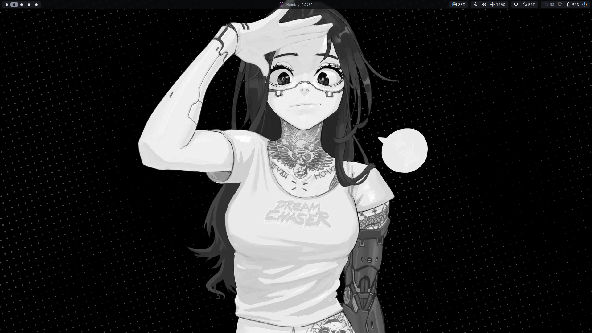
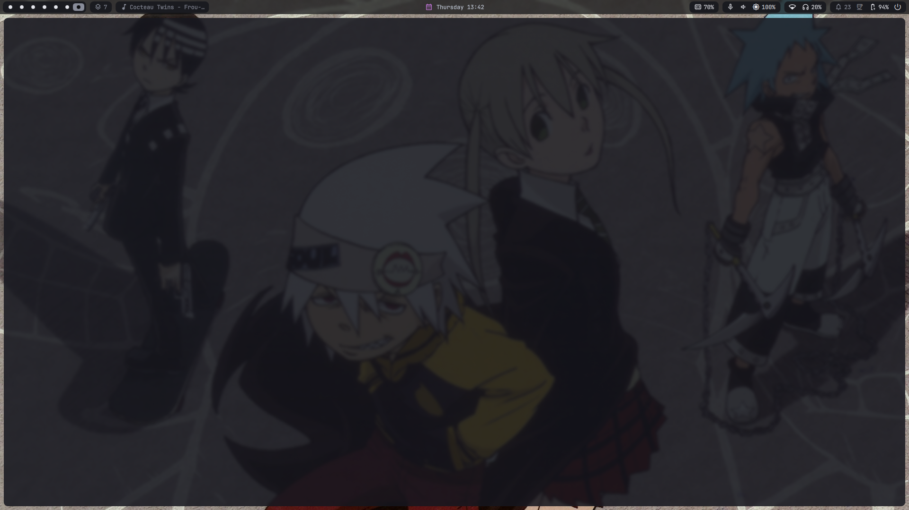
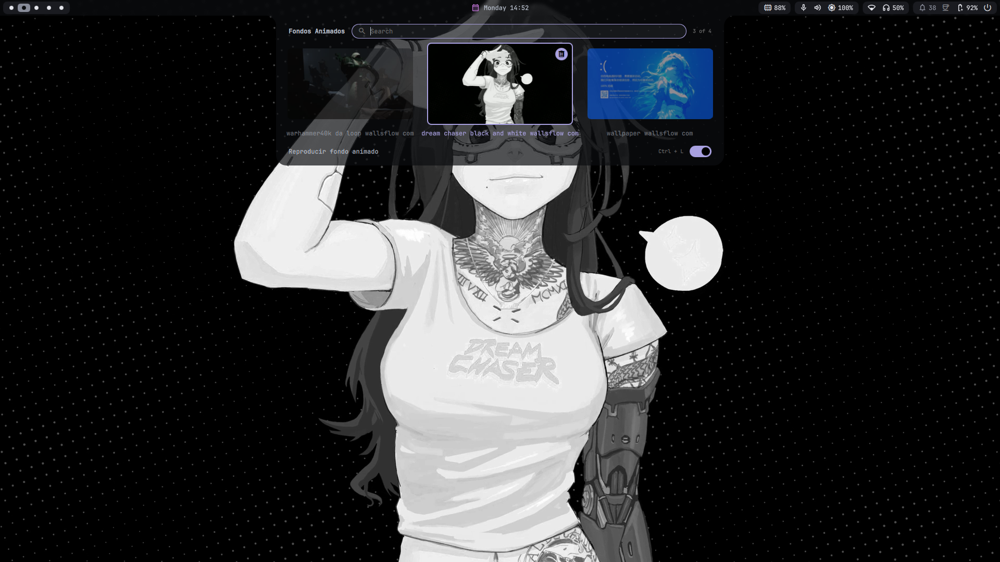
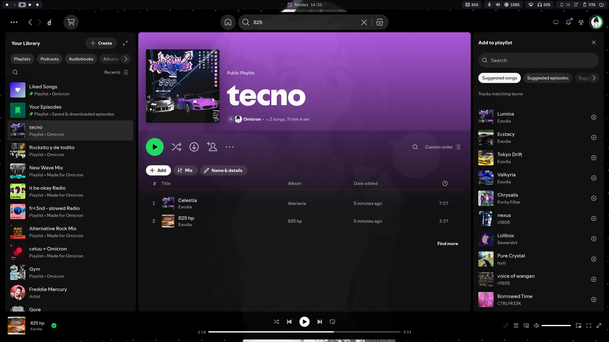

# Dotfiles y Configuracion del Sistema

Configuracion centralizada, modular y optimizada para **CachyOS / Arch Linux** bajo Wayland con **Hyprland**, **Quickshell**, **Fish Shell**, **Starship**, **Kitty** y el motor de fondos animados **Wallmotion**.

Disenado para maxima fluidez a 60 FPS, bajo consumo de recursos y estetica cuidada en portatiles con graficos integrados Intel UHD.

---

## Capturas del Entorno

### Escritorio Principal (Fondo Animado y Barra Quickshell)


### Terminal con Fastfetch y Starship Prompt


### Selector Visual de Fondos Animados (Quickshell Carousel)


### Aplicaciones y Diseno de Ventanas


---

## Especificaciones del Sistema de Referencia

- **Hardware:** ASUS Vivobook Go E1504GA
- **Procesador:** Intel Core i3-N305 (8 nucleos Gracemont hasta 3.8 GHz)
- **Graficos:** Intel UHD Graphics (32 EUs Alder Lake-N, soporte VAAPI QuickSync completo)
- **Memoria:** 8 GB LPDDR5 4800 MT/s
- **Pantalla:** 1920x1080 @ 60Hz (panel eDP-1)
- **Sistema Operativo:** CachyOS Linux (Kernel optimizado x86-64-v3)

---

## Pila de Software y Componentes

| Categoria | Herramienta | Ruta de Configuracion |
| :--- | :--- | :--- |
| **Compositor Wayland** | Hyprland 0.57.0 (Aquamarine, Lua) | `.config/hypr/` |
| **Barra y Paneles** | Quickshell (Hyprsimple / ii) | `.config/quickshell/` |
| **Fondos Animados** | Wallmotion (mpvpaper + VAAPI) | `.config/wallmotion/`, `scripts/wallmotion` |
| **Generador de Temas** | Matugen (Material You) | `.config/matugen/` |
| **Shell Principal** | Fish Shell | `.config/fish/` |
| **Shells de Respaldo** | Bash y Zsh | `home/.bashrc`, `home/.zshrc` |
| **Prompt** | Starship | `.config/starship.toml` |
| **Terminales** | Kitty / Ghostty | `.config/kitty/`, `.config/ghostty/` |
| **Lanzador de Apps** | Fuzzel | `.config/fuzzel/` |
| **Menu de Energia** | Wlogout | `.config/wlogout/` |
| **Monitor de Recursos** | Btop | `.config/btop/` |
| **Visualizador de Audio**| Cava | `.config/cava/` |
| **Servicios de Usuario** | Systemd User Units | `.config/systemd/user/` |
| **Scripts de Sistema** | Utilidades propias | `scripts/` |

---

## Subsistema de Fondos de Pantalla

El entorno soporta dos subsistemas complementarios de fondos con cambio en caliente y gestion automatica de capas en Wayland:

### 1. Fondos Estaticos con Temas
- **Atajo:** `SUPER + SHIFT + W`
- **Ubicacion:** `.config/hypr/themes/<tema>/backgrounds/`
- **Temas incluidos:** Doom One, Catppuccin, Deep Sea, Everforest, Gruvbox, Nord, Oxocarbon, Rosepine, Zenburn, etc.
- **Comportamiento:** Aplica el fondo mediante `hyprpaper`, ajusta la paleta de colores de la barra y notifica al usuario.

### 2. Fondos Animados por Hardware (Wallmotion)
- **Atajo:** `SUPER + SHIFT + T`
- **Ubicacion:** `.config/wallmotion/library/` (con miniaturas en `.config/wallmotion/thumbs/`)
- **Motor:** `mpvpaper` acelerado por hardware VAAPI (QuickSync VDBOX).
- **Optimizacion:**
  - Decodificacion directa en hardware sin carga de CPU (coste menor al 2.5% de CPU total en 4K 60 FPS).
  - Downscaling 2:1 entero de 4K a 1080p mediante samplers bilineales por hardware (2x2 SSAA), eliminando la sobrecarga de shaders y garantizando 0 caidas de fotogramas.
  - Convivencia automatica de capas: al activar un fondo animado se detiene temporalmente `hyprpaper.service` para evitar superposicion en Layer 0 (background); al pausar o volver a un fondo estatico, `hyprpaper.service` se restaura de inmediato.
  - Pausa inteligente en reposo controlada por `hypridle`.

---

## Optimizaciones de Rendimiento y Memoria

1. **ZRAM de 12 GB (Compresion ZSTD):**
   - Configurado en `/etc/systemd/zram-generator.conf` con prioridad 100.
   - Permite que cargas de trabajo pesadas (navegadores con decenas de pestañas, multiples IDEs, reproductor de musica y compositor) residan 100% en RAM comprimida a velocidad de bus LPDDR5.
   - Previene el desbordamiento al archivo de intercambio en disco NVMe, erradicando los micro-tirones por I/O.
2. **Priorizacion de Fotogramas en Hyprland:**
   - `render_unfocused_fps = 30`: Las ventanas en segundo plano reducen su tasa de repintado a 30 FPS, reservando el 100% del rendimiento de la GPU integrada para la ventana activa en foco a 60 FPS limpios.
   - Triple buffering dinamico habilitado (`render:new_render_scheduling = true`).
3. **Gestion Termica y de Corriente:**
   - Script `power-state-manager` para coordinar perfiles ACPI (`performance` / `balanced`), suelo minimo de GPU a 800 MHz con cargador para evitar latencias de cambio de reloj, y control de ventilador ASUS.
4. **Gobernador de Recursos de Espacios de Trabajo (`hypr-workspace-governor`):**
   - Servicio en segundo plano acoplado al socket IPC `.socket2.sock` de Hyprland.
   - Conmuta automáticamente los procesos de espacios inactivos a la política `SCHED_IDLE`, prioridad de proceso `nice 19` y clase de E/S ociosa (`ionice idle`), asegurando que solo el espacio de trabajo en foco consuma CPU y ancho de banda del bus.
   - Protección de audio integrada: detecta flujos de sonido activos vía PipeWire / PulseAudio (`pactl`) para no limitar reproductores como Spotify o videollamadas.
5. **Optimizaciones de Kernel y Memoria (Intel Alder Lake-N):**
   - Transparent Huge Pages (THP) en `madvise` para evitar la fragmentación de páginas de 2 MB en 8 GB de RAM física.
   - `vm.stat_interval = 10` para reducir en un 90% los despertares de temporizador de los núcleos Gracemont, facilitando estados C8/C10 de ultra-bajo consumo.


---

## Estructura del Repositorio

```text
.
├── .config/
│   ├── btop/               # Monitor del sistema con temas
│   ├── cava/               # Visualizador de audio
│   ├── environment.d/      # Variables de entorno y optimizaciones
│   ├── fish/               # Configuracion de Fish Shell
│   ├── fontconfig/         # Ajustes de tipografia
│   ├── fuzzel/             # Lanzador de aplicaciones
│   ├── ghostty/            # Terminal Ghostty
│   ├── gtk-3.0/ & gtk-4.0/ # Estilos GTK
│   ├── hypr/               # Configuracion completa de Hyprland (Lua)
│   │   ├── bindings/       # Atajos de teclado y aplicaciones
│   │   ├── themes/         # Temas visuales y fondos estaticos
│   │   ├── input.lua       # Touchpad, gestos y teclado
│   │   └── looknfeel.lua   # Renderizado, animaciones y decoracion
│   ├── kitty/              # Terminal Kitty
│   ├── matugen/            # Plantillas Material You
│   ├── mpv/ & mpvpaper/    # Perfiles de reproduccion de video
│   ├── quickshell/         # Barra superior y paneles
│   ├── starship.toml       # Estilo del prompt
│   ├── systemd/user/       # Servicios de usuario
│   ├── wallmotion/         # Biblioteca de fondos animados y miniaturas
│   └── wlogout/            # Pantalla de salida del sistema
├── assets/                 # Capturas de pantalla para documentacion
├── home/                   # Archivos para el directorio raiz del usuario (~/)
│   ├── .bashrc
│   ├── .gitconfig
│   ├── .vimrc
│   └── .zshrc
├── scripts/                # Herramientas y scripts de mantenimiento
│   ├── animated-wallpaper-picker.sh   # Generador de miniaturas y TSV para Quickshell
│   ├── animated-wallpaper-switcher.sh # Conmutador IPC para fondos animados
│   ├── battery-monitor.sh             # Monitor de bateria y perfiles de energia
│   ├── system-upgrade.sh              # Actualizador del sistema con guardia de rendimiento
│   ├── wallpaper-switcher.sh          # Conmutador de fondos estaticos
│   ├── wallmotion                     # Motor de fondos animados
│   └── README.md                      # Documentacion modular de scripts
├── install.sh              # Script instalador automatico con copia de seguridad
├── sync.sh                 # Sincronizador bidireccional (Sistema -> Repositorio)
├── .gitignore
└── README.md
```

---

## Instalacion y Despliegue

### Requisitos Previos

- Distribucion basada en Arch Linux (CachyOS recomendado)
- Paquetes esenciales: `hyprland`, `quickshell`, `fish`, `starship`, `kitty`, `mpv`, `mpvpaper`, `ffmpeg`, `rsync`

### Clonar el Repositorio

```bash
git clone https://github.com/anthra123x/my_linux.git ~/dotfiles
cd ~/dotfiles
```

### Opciones de Instalacion

#### 1. Modo Simbolico (Recomendado)
Crea enlaces simbolicos desde el sistema hacia el repositorio para versionar cambios en vivo:
```bash
./install.sh --symlink
```

#### 2. Modo Copia Directa
Copia los archivos a sus destinos definitivos sin enlaces:
```bash
./install.sh --copy
```

Ambos metodos generan un respaldo preventivo de cualquier configuracion existente en `~/.dotfiles_backup_<FECHA>/`.

---

## Sincronizacion de Cambios

Para reflejar modificaciones locales del sistema dentro del repositorio antes de hacer commit:

```bash
# Ver diferencias entre el sistema y el repositorio:
./sync.sh --diff

# Traer los cambios del sistema hacia el repositorio:
./sync.sh --pull
```

---

## Atajos de Teclado Principales

| Combinacion | Accion |
| :--- | :--- |
| `SUPER + Return` | Abrir terminal (Ghostty / Kitty) |
| `SUPER + Space` | Lanzador de aplicaciones (Fuzzel) |
| `SUPER + Q` | Cerrar ventana activa |
| `SUPER + SHIFT + W` | Selector visual de fondos estaticos por tema |
| `SUPER + SHIFT + T` | Selector visual de fondos animados (Quickshell) |
| `SUPER + Ctrl + L` | Conmutar reproduccion de fondo animado (Play / Pause) |
| `SUPER + [1-9]` | Cambiar al espacio de trabajo 1-9 |
| `SUPER + SHIFT + [1-9]` | Mover ventana al espacio de trabajo 1-9 |
| `SUPER + Escape` | Menu de energia y apagado (Wlogout) |
